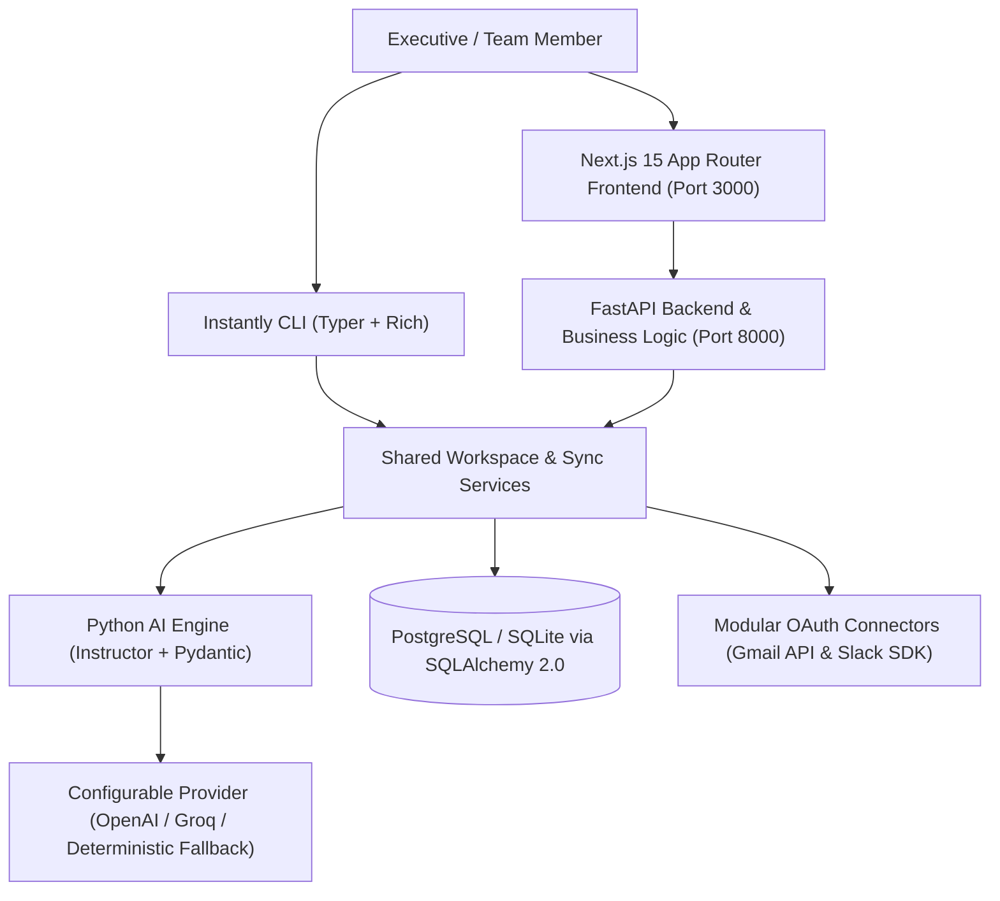

# INSTANTLY — System Architecture & Database Design

## 1. High-Level Architecture

Instantly is architected as a modular monorepo separating presentation, core business intelligence, external platform connectors, and command-line operations while sharing a single persistent database and AI engine.

## 2. Core Architectural Principles

1. **Single Source of Truth**: Both the Next.js web application and the Typer CLI operate against the same SQLAlchemy models and service layer (`backend/app/services/workspace_service.py`).
2. **Untrusted Content Isolation**: Incoming emails and Slack messages are wrapped inside `<untrusted_message>` delimiters and scanned by `sanitize_untrusted_text()` before LLM inference. Instructions embedded inside incoming communications cannot override system prompts.
3. **Provider-Agnostic Structured AI**: `IntelligenceEngine` (`backend/app/ai/engine.py`) uses `instructor` and `Pydantic` schemas (`AIAnalysisSchema`) to guarantee validated JSON outputs across OpenAI, Groq, and the built-in zero-credential deterministic engine.
4. **Separation of AI Analysis vs. Human Task Completion**: `AIAnalysis.analyzed_at` records when the AI finished triaging a message, whereas `Message.priority_status` and `Task.status` track when the human user actually completes or snoozes the required action.

## 3. Database Schema Overview

All entities reside in `backend/app/models/entities.py` and are managed via SQLAlchemy 2.0 and Alembic migrations:

| Table | Purpose | Key Constraints / Indexes |
| :--- | :--- | :--- |
| `users` | Authenticated platform users | Unique index on `email` |
| `workspaces` | Multi-tenant workspaces isolating messages & tasks | Unique `slug`, `owner_id` FK |
| `workspace_memberships` | Role-based membership (`Owner`, `Admin`, `Member`) | `uq_workspace_user` unique constraint |
| `workspace_invitations` | Pending team invitations | Indexed by `workspace_id` |
| `integrations` | Connection state per platform (`gmail`, `slack`) | `uq_workspace_platform` unique constraint |
| `integration_credentials` | Fernet-encrypted OAuth access/refresh tokens | Separated 1:1 from `integrations` |
| `conversations` | Grouped threads across Gmail and Slack | Indexed by `external_thread_id` |
| `messages` | Consolidated communications | `uq_workspace_source_external_id` prevents duplicates |
| `ai_analyses` | Structured AI classification, summary, and deadline | 1:1 with `messages`, indexed by `urgency` |
| `suggested_replies` | Editable AI reply drafts across tones | 1:N with `messages` |
| `tasks` | Action items & follow-ups (explicit vs. AI-inferred) | Linked optionally to `messages.id` |
| `message_assignments` | Teammate ownership handoffs | 1:N with `messages` |
| `internal_comments` | Internal workspace discussion notes | 1:N with `messages` |
| `sync_history` | Audit trail of manual and scheduled sync runs | Indexed by `workspace_id` |
| `user_preferences` | Per-user AI provider, tone, and notification settings | 1:1 with `users` |
| `audit_events` | Security and operational audit trail | Indexed by `workspace_id` |
| `notifications` | High-priority alerts surfaced in top bar | Indexed by `workspace_id` |

